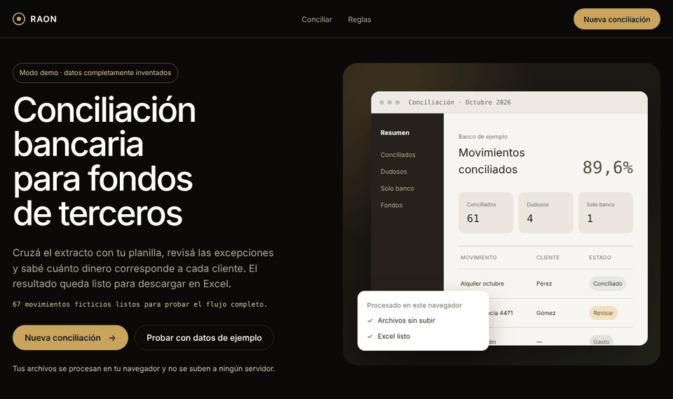
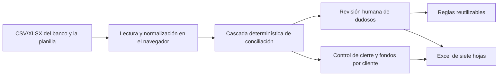

# Conciliación bancaria RAON

Conciliá el extracto del banco con tu planilla en minutos y sabé cuánta plata es de cada cliente.




## El problema

- Los bancos y las planillas exportan fechas, importes y encabezados con formatos distintos.
- Un cruce manual consume horas y puede usar dos veces el mismo movimiento o esconder una diferencia.
- Quien administra fondos de terceros necesita explicar qué concilió, qué falta y cuánto pertenece a cada cliente.

### Qué hace

- Lee CSV y XLSX, detecta columnas y muestra cómo interpretó fechas e importes antes de conciliar.
- Cruza movimientos con una cascada determinística de exactos, tolerancias, agrupaciones y reglas.
- Señala dudosos, faltantes, gastos bancarios y cortes en el saldo para revisión humana.
- Calcula fondos por cliente y compara el total adeudado a terceros con el saldo bancario.
- Genera un Excel auditable de siete hojas, con filas originales, motivos, estados y reglas aplicadas.

## Demo en vivo

[Enlace a la demo — completar](https://example.com)

El modo demo usa únicamente los archivos inventados de `public/demo/`.

## Cómo funciona



## Decisiones técnicas

- **Procesamiento en el navegador:** los archivos y movimientos se leen en un Web Worker y permanecen en memoria; el route handler de IA nunca recibe archivos.
- **Montos en centavos:** el dominio usa enteros para evitar errores de coma flotante y recién formatea al mostrar o exportar.
- **Motor determinístico:** cada movimiento se consume una sola vez, el orden no depende del idioma del sistema y los casos límite tienen tests unitarios, golden, de determinismo y rendimiento.
- **IA que sólo sugiere:** está apagada por defecto, analiza como máximo 50 dudosos con datos mínimos y nunca cambia el estado ni acepta un candidato por su cuenta.
- **Reglas que aprenden de la revisión:** al aceptar un dudoso, la persona puede guardar un patrón editable para próximas conciliaciones.

## Seguridad y privacidad

Los archivos, sus bytes y los movimientos completos no se envían ni se guardan en el servidor. En modo local, reglas, plantillas y hasta 50 resúmenes agregados quedan en `localStorage`. Con Supabase configurado, esos mismos datos de configuración y totales se aíslan por organización mediante RLS; nunca se persisten extractos ni movimientos.

La CSP limita conexiones del navegador a la propia aplicación y agrega el origen exacto de Supabase sólo cuando sus variables son válidas. También se envían `frame-ancestors 'none'`, `X-Content-Type-Options: nosniff`, `Referrer-Policy: strict-origin-when-cross-origin` y una `Permissions-Policy` restrictiva. CI ejecuta gitleaks y CodeQL, y Dependabot revisa npm y GitHub Actions semanalmente. El diseño toma la Ley 18.331 de Uruguay como marco de privacidad, sin afirmar certificaciones.

### Supabase opcional

Sin estas variables, o con los placeholders de `.env.example`, la app funciona igual en modo local y no muestra login:

```dotenv
NEXT_PUBLIC_SUPABASE_URL=https://<proyecto>.supabase.co
NEXT_PUBLIC_SUPABASE_PUBLISHABLE_KEY=sb_publishable_...
```

Aplicá en orden las migraciones de `supabase/migrations/`, agregá `/auth/callback` a las redirect URLs del proyecto y pedí el enlace desde `/cuenta`. También se admite `NEXT_PUBLIC_SUPABASE_ANON_KEY` para proyectos con clave pública legacy; nunca uses `service_role` en una variable `NEXT_PUBLIC_*`.

`tests/rls.test.ts` aplica las migraciones sobre PGlite y cubre alta inicial, aislamiento, escrituras cruzadas, miembros, permisos anónimos y autoría. En un Supabase real todavía hay que probar el magic link, las redirecciones de rutas protegidas y el retorno al modo local al quitar las variables.

### IA opcional

La IA permanece apagada con la configuración predeterminada. Para habilitar Gemini REST del lado servidor:

```dotenv
AI_ENABLED=true
AI_MODEL=gemini-2.5-flash
GEMINI_API_KEY=<secreto-del-servidor>
```

El navegador envía a `/api/ia` sólo fecha, descripción, monto y cliente de los dudosos y sus candidatos. La entrada y la salida se validan con Zod, el pedido se limita a 50 casos y se aborta a los 10 segundos. Con datos reales de clientes, usá solo un proveedor que no entrene con tus datos (plan pago). Los tests inyectan un proveedor falso y nunca llaman a Gemini ni a otro proveedor real.

Consultá [SECURITY.md](SECURITY.md) para reportar una vulnerabilidad sin exponer datos.

## Correr localmente

```bash
npm ci
npm run conciliar -- --banco test-data/banco.csv --planilla test-data/planilla.csv --moneda UYU
npm run dev
```

La CLI imprime el resumen y genera el Excel en `salida/`; la web queda en `http://localhost:3000`. Todo `test-data/` es inventado: probá también `banco_formato_b.xlsx` y `banco_saldo_roto.csv`. Para cargar la demo desde la interfaz, definí `NEXT_PUBLIC_DEMO_MODE=true`; no hace falta configurar Supabase ni IA.

La verificación completa se ejecuta con:

```bash
npm run lint
npm run typecheck
npm test
npm run build
npm audit
```

## Estructura y cobertura

```text
app/                  rutas, endpoint de IA y cabeceras Next.js
components/           asistente, resultados, cuenta, reglas e historial
lib/lectura/          CSV/XLSX y detección de encabezados
lib/normalizar/       fechas, montos, texto, moneda y orden
lib/motor/            cascada pura y revisión manual
lib/cierre/           control de saldo general y fila por fila
lib/saldos/           fondos de terceros por cliente
lib/excel/            libro de siete hojas
lib/ia/               contrato, Gemini REST, cliente, Zod y timeout
lib/almacen/          persistencia local o Supabase
supabase/migrations/  esquema, RLS y permisos
tests/                unitarios, golden, rendimiento, API, CSP y RLS
```

Vitest cubre todas las variantes regionales de la SPEC, cada paso del motor, aceptación de dudosos, cierre, saldos, Excel, Web Worker, almacenamiento, RLS real con PGlite, IA con proveedor falso y CSP condicional. GitHub Actions ejecuta lint, TypeScript, la suite y el build en cada push y pull request.

## Roadmap

- Leer extractos PDF a partir de muestras reales de cada banco.
- Conectar directamente con bancos.
- Invitar a más miembros a una organización.
- Integrar el sistema de cobranza para avisar pagos automáticamente.

## Autor

**RAON** — Juan Martín Rampa Lanese (JuanMa)

- Web: [completar](https://example.com)
- LinkedIn: [completar](https://www.linkedin.com)
- Contacto: [completar](mailto:contacto@example.com)

## Licencia

© 2026 RAON. Todos los derechos reservados. El código se publica para mostrar el trabajo; para usarlo en tu negocio, contactanos.
